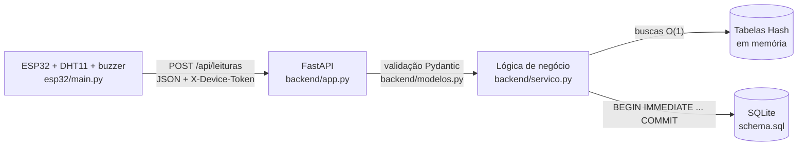

# Telemetria com ESP32 — Sensor de temperatura + API em Python

O **ESP32** lê temperatura e umidade com um **DHT11**. Quando a média chega ao limite configurado
(padrão **23 °C**), o **LED pisca** e o **buzzer apita** até a temperatura cair. Cada leitura é
enviada em **JSON** para um **backend em Python (FastAPI)**, que valida a requisição, autentica a
placa, grava a leitura como **transação** de forma **atômica** no **SQLite**, atualiza o **saldo**
consolidado do dispositivo e registra tudo em **logs de auditoria**.

## Integrantes

- Patrícia Cedraz
- Kiara Souza
- Rodrigo Aguiar ([@Rodrigo300511](https://github.com/Rodrigo300511))
- Vitor Argay

> O firmware de alarme (versão 2, em `esp32/versoes_anteriores/`) e a documentação de hardware
> partiram do [repositório original de Rodrigo Aguiar](https://github.com/Rodrigo300511/Projeto-Telemetria-Banco---Sensor-de-temperatura).

---

## Arquitetura



## Arquivos

| Arquivo | O que faz |
|---|---|
| `esp32/main.py` | **Firmware (v3.0)**: leitura do DHT11, alarme LED + buzzer, envio JSON com fila offline |
| `esp32/config.exemplo.py` | Modelo de configuração (Wi-Fi, URL da API, id e token). Copiar para `config.py` |
| `esp32/versoes_anteriores/` | Versão 2 do sensor (alarme só local, sem rede) |
| `backend/app.py` | Rotas da API (FastAPI) |
| `backend/modelos.py` | Validação das requisições (Pydantic) |
| `backend/servico.py` | Regra de negócio, transação atômica e auditoria |
| `backend/tabela_hash.py` | Tabela Hash própria (encadeamento separado + rehash) |
| `schema.sql` | Modelo relacional do banco |
| `simulador_esp32.py` | Simula a placa para demonstrar sem hardware |
| `tests/test_api.py` | 14 testes automatizados |

---

## Componentes

| Componente | Modelo usado | Observação |
|---|---|---|
| Placa | ESP32 (ESP32-D0WD-V3, DevKit) | MicroPython v1.29.0 |
| Sensor de temperatura e umidade | DHT11 (azul) | Faixa 0–50 °C, ±2 °C |
| LED | LED azul da própria placa (GPIO2) | Nenhuma ligação extra |
| Buzzer | PUI Audio AT-1224-TWT-5V-2-R | Transdutor magnético **passivo** (precisa de PWM), ~2 kHz |
| Resistor | 100 Ω (marrom-preto-marrom) | Limita a corrente do pino do buzzer |
| Diodo (opcional) | 1N4148 ou 1N4007 | Em paralelo com o buzzer, faixa no (+) |

---

## Ligações

| Componente | Pino do componente | Pino do ESP32 |
|---|---|---|
| DHT11 | VCC (+) | 3V3 |
| DHT11 | DATA (OUT/S) | **GPIO4** (D4) |
| DHT11 | GND (−) | GND |
| Buzzer | (+) | **GPIO18** (D18) através do resistor de 100 Ω |
| Buzzer | (−) | GND |
| LED | — | GPIO2 (LED interno da placa) |

```
GPIO4  ───────────────────► DATA  (DHT11)
3V3    ───────────────────► VCC   (DHT11)
GND    ───────────────────► GND   (DHT11)

GPIO18 ──[ 100 Ω ]────────► (+) buzzer
GND    ───────────────────► (−) buzzer
```

> **Não use GPIO0 nem GPIO1 no ESP32.** O GPIO1 é o TX da USB (é por ele que o Thonny
> conversa com a placa) e o GPIO0 é o pino de boot.

---

## Instalação do MicroPython na placa

1. Instale o [Thonny](https://thonny.org).
2. Conecte o ESP32 via USB. Se não aparecer porta COM, instale o driver USB
   (CP210x ou CH340, conforme o chip ao lado do conector).
3. No Thonny: **Ferramentas > Opções > Interpretador**
   - Interpretador: **MicroPython (ESP32)**
   - Porta: a COM da placa (ex.: COM6)
4. Clique em **Install or update MicroPython (esptool)**:
   - MicroPython family: **ESP32**
   - Variant: **Espressif • ESP32 / WROOM**
   - Marque **Erase all flash before installing**
   - Clique em **Install**
5. Se der erro de conexão: segure o botão **BOOT**, aperte e solte **EN**, clique em
   **Install** e solte o BOOT quando começar a gravação.
6. Clique em **Stop/Restart**. O Shell deve mostrar `MicroPython v1.29.0 ...` e `>>>`.

---

## Como rodar

### 1. Servidor (no computador)

```bash
python -m venv .venv
.venv\Scripts\activate          # Windows  (Linux/Mac: source .venv/bin/activate)
pip install -r requirements.txt

uvicorn backend.app:app --host 0.0.0.0 --port 8000
```

Na primeira execução o banco `dados/telemetria.db` é criado a partir do `schema.sql` e o dispositivo
`esp32-01` é cadastrado com o token de `TOKEN_DISPOSITIVO` (padrão `troque-este-token`) e o limite de
`LIMITE_ALARME` (padrão `23.0`, o mesmo do `main.py`).

Documentação interativa (Swagger): **http://localhost:8000/docs**

### 2. Placa (Thonny)

1. Copie `esp32/config.exemplo.py` para `esp32/config.py` e preencha o Wi-Fi, o **IP do computador**
   que roda o servidor e o token.
2. Salve na placa (**Arquivo > Salvar como > MicroPython device**): `config.py` e `main.py`.
   Como `main.py`, o programa roda sozinho ao ligar a placa.
3. Se aparecer `ImportError: no module named 'urequests'`, rode no Shell (placa já no Wi-Fi):
   `import mip; mip.install("urequests")`.
4. ESP32 e computador precisam estar na **mesma rede**; no Windows, libere a porta 8000 no firewall.
5. Um **bip curto** confirma o buzzer. A cada 2 s o Shell mostra a leitura e a resposta do servidor:

   ```
   Atual: 23.6 C | Media: 23.4 C | Umidade: 73 % | Alarme: LIGADO
     -> servidor: aceita | alarme servidor: True | media geral: 22.8 C
   ```

6. Para parar: digite **`q`** e aperte **Enter** (ou **Ctrl+C**). LED e buzzer são desligados.

### 3. Sem a placa (demonstração)

Com o servidor rodando, em outro terminal:

```bash
python simulador_esp32.py --cenarios
```

Envia 15 leituras (a temperatura sobe, dispara o alarme e normaliza) e depois testa reenvio
duplicado, token errado e JSON inválido.

---

## Configurações do firmware

Ficam no início de `esp32/main.py`:

| Variável | Padrão | Função |
|---|---|---|
| `LIMITE` | `23.0` | Temperatura (°C) que dispara o alarme — manter igual a `LIMITE_ALARME` do servidor |
| `HISTERESE` | `0.5` | O alarme só desliga abaixo de `LIMITE - HISTERESE` (evita liga/desliga) |
| `MEDIA_N` | `3` | Leituras na média móvel (use `1` para reagir na hora) |
| `INTERVALO_MS` | `2000` | Intervalo entre leituras do sensor (DHT11: mínimo ~1 s) |
| `VELOCIDADE_MS` | `250` | Velocidade da piscada e do bip (menor = mais rápido) |
| `FREQ_BUZZER` | `2048` | Frequência do som (ajuste para a mais alta do seu buzzer) |
| `FILA_MAX` | `20` | Leituras guardadas enquanto o servidor estiver fora do ar |

## Como o firmware funciona

- **Leitura do DHT11 com casa decimal:** o `dht.DHT11` do MicroPython descarta o decimal.
  O código lê os bytes brutos (`sensor.buf`) e monta `inteiro + decimal / 10`.
- **Tentativas e filtro:** até 3 tentativas por leitura; valores fora de 0–50 °C ou 5–95 % são descartados.
- **Média móvel:** suaviza oscilações antes de decidir o alarme.
- **Timer:** um `machine.Timer` chama `piscar()` a cada `VELOCIDADE_MS`, invertendo o LED e
  ligando/desligando o buzzer junto. Assim o alarme não para enquanto o código espera o sensor
  ou a resposta do servidor.
- **Envio idempotente:** cada leitura recebe um `id_transacao` (`<dispositivo>-<boot>-<seq>`). Se a
  rede cair, a leitura fica na fila e é reenviada; o servidor reconhece reenvios e não duplica.
- **Leitura do teclado sem travar:** `select.poll()` verifica se foi digitado `q` sem bloquear o loop.
- **Encerramento seguro:** o bloco `finally` para o Timer e desliga LED e buzzer.

---

## API

| Método | Rota | Descrição |
|---|---|---|
| POST | `/api/leituras` | Recebe a leitura do ESP32 (cabeçalho `X-Device-Token`) |
| GET | `/api/saldos/{dispositivo_id}` | Saldo consolidado — lido da tabela hash, O(1) |
| GET | `/api/transacoes?dispositivo_id=&limite=` | Últimas transações gravadas |
| GET | `/api/auditoria?evento=&limite=` | Trilha de auditoria |
| GET | `/health` | Verificação de saúde |

Exemplo de corpo enviado pelo ESP32:

```json
{
  "dispositivo_id": "esp32-01",
  "id_transacao": "esp32-01-a1b2c3d4-000042",
  "seq": 42,
  "temperatura": 26.4,
  "umidade": 61.0,
  "media_movel": 26.13,
  "alarme": true
}
```

Respostas: `200` aceita ou duplicada · `401` dispositivo/token inválido · `422` JSON inválido · `500` erro interno (com rollback).

## Validação das requisições

Feita pelo Pydantic antes de qualquer acesso ao banco: tipos e faixas do DHT11 (0–50 °C, 5–95 %), `alarme` booleano estrito, campos extras recusados e `id_transacao` obrigatoriamente prefixado pelo `dispositivo_id`. Toda rejeição (422 ou 401) é gravada em `logs_auditoria` com o IP de origem e o motivo.

## Modelo relacional (`schema.sql`)

| Tabela | Papel |
|---|---|
| `dispositivos` | Placas autorizadas: hash SHA-256 do token, limite de alarme e histerese |
| `transacoes` | Uma linha por leitura aceita. `id_transacao UNIQUE` garante idempotência. Imutável (triggers bloqueiam UPDATE/DELETE) |
| `saldos` | Estado consolidado por dispositivo (1:1): total de leituras, soma, mín./máx., última leitura, alarme ativo, total de alarmes, versão |
| `logs_auditoria` | Append-only: aceites, duplicadas, rejeições, mudanças e divergências de alarme, erros internos |

## Tabelas Hash — buscas O(1)

`backend/tabela_hash.py` implementa uma tabela hash com **encadeamento separado** e **rehash** automático quando o fator de carga passa de 0,75 (custo amortizado O(1) na inserção). O serviço mantém três instâncias:

| Tabela | Chave → valor | Uso |
|---|---|---|
| `_dispositivos` | id do dispositivo → configuração | Autenticação a cada requisição sem ir ao banco |
| `_ids_processados` | id_transacao → resposta | Detecta reenvio do ESP32 antes de abrir transação |
| `_saldos` | id do dispositivo → saldo | `GET /api/saldos/{id}` direto da memória |

Os caches só são atualizados **depois do COMMIT**, então nunca exibem um estado que o banco não confirmou. Se o servidor reiniciar e o cache de ids zerar, o `UNIQUE` do banco continua barrando duplicidades.

## Atualização atômica

Cada leitura é processada numa única transação de banco:

```
BEGIN IMMEDIATE                       -- trava de escrita já no início
  INSERT INTO transacoes ...
  UPDATE saldos SET total_leituras = total_leituras + 1,
                    soma_temperatura = soma_temperatura + :t, ...
  INSERT INTO logs_auditoria ...      -- aceite (+ ALARME_LIGADO/DESLIGADO)
COMMIT                                -- ou ROLLBACK de tudo se algo falhar
```

Os incrementos acontecem dentro do próprio SQL (`campo = campo + ?`), sem ler-modificar-gravar no Python, e um `threading.Lock` serializa as escritas entre as threads do servidor. O teste `test_atomicidade_rollback_total` força uma falha no UPDATE do saldo e comprova que a transação inserida antes dele também é desfeita.

## Testes

```bash
pytest -v
```

Cobrem a tabela hash (inserção, atualização, remoção e rehash), leitura aceita e saldo, idempotência (pelo cache e pelo banco após reinício), autenticação, seis casos de validação, alarme com histerese, rollback atômico e imutabilidade dos logs.

## Migrando para PostgreSQL

O modelo é o mesmo; mudam os tipos e a sintaxe: `INTEGER PRIMARY KEY AUTOINCREMENT` → `BIGINT GENERATED ALWAYS AS IDENTITY`, `TEXT` de data → `TIMESTAMPTZ DEFAULT now()`, `INTEGER CHECK (IN (0,1))` → `BOOLEAN`, `detalhes TEXT` → `JSONB`, `BEGIN IMMEDIATE` → `BEGIN` + `SELECT ... FROM saldos WHERE dispositivo_id = %s FOR UPDATE`, e os triggers de imutabilidade passam a ser funções `plpgsql`.

---

## Solução de problemas

| Sintoma | Causa | Solução |
|---|---|---|
| "Device is busy or does not respond" e números sem parar | Placa com programa **Arduino** gravado (não é MicroPython) | Instalar o MicroPython (ver seção acima) |
| `IndentationError: unexpected indent` | Espaço sobrando no começo de alguma linha ao colar | `Ctrl+A`, apagar e colar de novo, ou abrir o arquivo `.py` |
| "Erro ao ler o sensor" | Ligação errada ou tipo de sensor errado | Conferir DATA no GPIO4, VCC no 3V3; testar `DHT11` e `DHT22` |
| Temperatura absurda (ex.: 589 °C, umidade 1869 %) | Sensor DHT11 lido como DHT22 | Usar `dht.DHT11(Pin(4))` |
| Sensor só muda de 1 em 1 grau | Limitação do DHT11 | Normal; para mais precisão use DHT22 ou DS18B20 |
| LED funciona, buzzer mudo | Pino, polaridade ou resistor errados | Conferir D18, inverter pernas, resistor marrom-preto-marrom |
| Buzzer baixo | Buzzer de 5 V alimentado com 3,3 V | Ver "Aumentar o volume" abaixo |
| `servidor indisponivel` no Shell | IP errado em `config.py`, redes diferentes ou firewall | Conferir IP (`ipconfig`), mesma rede Wi-Fi, liberar a porta 8000 |
| `REJEITADA (401)` | Token da placa diferente do servidor | Igualar `TOKEN` em `config.py` e `TOKEN_DISPOSITIVO` |

### Teste rápido do buzzer (no Shell)

```python
from machine import Pin, PWM; import time
b = PWM(Pin(18), freq=2048, duty=512); time.sleep(2); b.duty(0)
```

### Aumentar o volume do buzzer

1. **Achar a frequência mais alta** e colocar em `FREQ_BUZZER`:

   ```python
   from machine import Pin, PWM; import time
   b = PWM(Pin(18), freq=2000, duty=0)
   for f in (1500, 2000, 2048, 2300, 2400, 2700, 3000, 3500, 4000):
       print(f); b.freq(f); b.duty(512); time.sleep(0.8); b.duty(0); time.sleep(0.4)
   ```

2. **Resistor menor:** 68 Ω (mínimo 47 Ω sem transistor).
3. **Dois pinos em oposição:** (−) do buzzer no **GPIO19** em vez do GND, com PWM
   invertido. Dobra a variação de tensão no buzzer.

   ```python
   a = PWM(Pin(18), freq=2048, duty=512)
   b = PWM(Pin(19), freq=2048, duty=512, invert=True)
   ```

4. **Transistor (BC547 / 2N2222) + 5 V (pino VIN):** volume máximo do buzzer.

---

## Próximos passos

- [ ] Definir a frequência de maior volume do buzzer
- [ ] Aumentar o volume (dois pinos ou transistor)
- [ ] (Opcional) Trocar o DHT11 por DHT22 ou DS18B20 para mais precisão
- [ ] (Opcional) Migrar o banco para PostgreSQL
